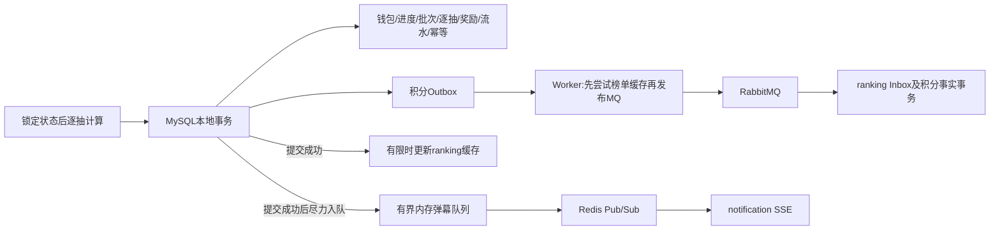

# activity-service 活动核心设计方案

日期：2026-11-05。状态：已采用服务级 application/interfaces 编排与上下文仓储分层；本轮代码测试通过，真实依赖联调尚未重跑。

> 最新实施说明：完整业务用例位于 `internal/application`，HTTP、消息与任务触发入口位于 `internal/interfaces`；`assets/lottery/participation` 各自保留领域规则、公开应用能力和仓储实现。已移除共享 `appstate`、旧 `uow` 和 `Legacy`。事务会话只组合仓储能力，同一 `sql.Tx` 绑定三个上下文和 Outbox。当前结构、测试与验证边界见 [分层重构说明](activity-service分层重构说明.md)。

依据：[业务需求 V1.2](Lottery业务需求文档（不含后台）.md)、[持久层 V2](持久层设计方案V2.md)、现有核心库迁移，以及 [identity 方案](identity-service实现方案.md)、[ranking 方案](ranking-service设计方案.md)、[notification 方案](notification-service设计方案.md)。发生差异时，下文明确指出设计增补，不能把建议当成已实现能力。

## 1. 核心决策与建议评估

活动核心是一个部署服务，内部拆 participation、lottery、assets 三个限界上下文。扣费、抽奖、发奖、花朵进度和可靠事件共同使用 activity_core 的一个 MySQL 本地事务。内部模块不再拆远程服务。

|建议|决策|具体约束|
|---|---|---|
|整数权重抽奖|采纳|均匀整数随机数加累计权重区间；不使用浮点概率或取模随机数|
|先算后写、批量 insert|采纳|取得数据库锁后，在内存逐抽演算，再按表批量写入；各批仍在一个事务内|
|资产用 UPDATE WHERE 原子扣减|采纳|数据库检查足额，余额增减及流水同事务；先验证申请全额，不能中奖后倒付|
|Redis 分布式锁|采纳为并发入口控制|快速返回冲突；MySQL 行锁与条件更新保障最终状态，不能只依赖 Redis 租约|
|幂等|采纳|普通抽奖24小时恢复、永久拒绝旧标识复用；其他业务用自然唯一键及状态机|
|EventBus 解耦|采纳应用端口|积分用事务 Outbox + RabbitMQ，弹幕用提交后有界内存队列 + Redis Pub/Sub，符合已有两份方案|

不引入通用工作流引擎、分布式事务、数据库代理或额外注册中心。初期 Compose 管理 MySQL、Redis、RabbitMQ 和服务；目前没有实际流量与部署资源数据，不估算虚构的 QPS。

## 2. 模块、目录与依赖

|上下文|领域职责|应用用例|
|---|---|---|
|participation|期次、版本化规则、轮回、花朵、阶段、宝箱|参与初始化、领取阶段、开箱/确认、开启下一轮、结算进度|
|lottery|权重采样、逐抽演算、固定结果、预览状态机|普通抽奖、预览生成/恢复/确认/放弃、抽奖记录|
|assets|钱包、分类流水、购买限额、奖励与选择权益|购买/补差/礼包、奖励查询/选款、排名奖励入账|

服务统一使用 `internal/interfaces/http` 承接 Gin 路由、绑定、校验和错误映射；消息入口在 `interfaces/messaging`，定时触发在 `interfaces/worker`。三个上下文分别保留 `domain/application/infrastructure`。领域和应用层不依赖 Gin、SQL、Redis、MQ 或混合平台包，接口使用标准 context.Context。

服务级 `internal/application` 编排抽奖、阶段发奖、预览确认和结算，调用三个上下文公开能力；上下文之间不互相调用应用服务。共用的事务执行器创建一个连接上的事务会话，注入三个模块仓储实现；模块不得私自开启、提交嵌套事务。仓储接口与领域模型不暴露 sql.Tx，基础设施负责绑定。事务、用户互斥、规则加载、时钟、ID、随机源、可靠事件记录及提交后通知均是可替换端口，不建立一个包含全部业务的公共包。

跨服务仅通过认证内部契约通信：identity 提供身份和初始化事件；ranking 消费积分并生成排名奖励；notification 分发弹幕。核心不读写其他服务的库或榜单 Redis。

## 3. 领域不变量与规则版本

- 钱包为账号级，金币、花瓣非负，换期不重发。轮进度和资格按期次隔离，换轮保留期内积分。
- 普通抽奖请求次数只能为1/10/30，奖池为白昼/星夜；每个实际抽次恰有一个奖品，普通池放回采样。每轮最多18朵，满轮停止且不跨轮。
- 每次正式消耗花瓣的60倍推进本轮累计金币等价值；仅实际消耗计积分。中奖花瓣不能用于满足本次申请前的余额检查。
- 原始抽奖快照和逐抽结果不可修改；选款只更新对应 reward_grant 的最终奖励字段。
- 宝箱开奖与奖励获得、宝箱流程确认是不同状态。普通戒指开奖即可获得，箱子仍待确认。

规则 JSON 以 `(edition_id, version)` 不可变保存，缓存以版本为键；抽奖绑定轮版本，预览绑定生成时版本。**建议**同轮使用固定版本、下轮采用新生效版本；属于 V2 尚待确认项，不在本稿擅自视为既定玩法。确认前不支持活动中任意热改已引用规则。

加载规则时校验奖池非空、总权重为正且加法不溢出、单项权重非负、至少一项可命中；零权重不进入采样区间。校验数量为正、道具引用、18朵概率、单调保底阈值、阶段节点及三种宝箱候选/选款引用。所有费用、资产和累计分数采用检查溢出的整数运算，超限拒绝新交易并报警，不能截断。规则缓存未命中从核心库读取，Redis 不保存唯一规则副本。

## 4. 整数权重与逐抽算法

### 4.1 奖品抽取

给定权重 `w[i]`，预计算前缀和 `prefix[i]` 和总和 W。均匀生成 `r ∈ [0,W)`，取第一个 `prefix[i] > r` 的奖品。权重1、1、1时，三个区间分别是 `[0,1)`、`[1,2)`、`[2,3)`，概率各1/3；并不保证每三抽恰好各中一次。

默认白昼奖池可用 `350,250,200,100,70,25,5`，总和1000；整数权重表达相对比例，配置中的小数百分比需精确转换为整数比，不能先转 float 再舍入。构建 O(K)，单次二分 O(log K)；当前奖品少，顺序扫描也可，不引入 Alias 表复杂度。

生产随机源建议使用 crypto/rand 的均匀有界整数采样，错误使整笔回滚；不使用时间种子、不对随机字节直接 `% W`，避免模偏差。测试注入固定随机序列。[Go crypto/rand 文档](https://pkg.go.dev/crypto/rand#Int)说明其 Int 产生 `[0,max)` 均匀整数。实际性能以后续压测为准，不以安全随机为由承诺吞吐。

### 4.2 点亮与保底

花朵概率与奖品权重独立采样。建议概率使用百万分率：`0.004%=40/1,000,000`，均匀生成 `[0,1,000,000)` 后比较；不支持的精度配置直接拒绝，不能默默截断。每实际抽次如下：

```text
累计金币等价值 += 本抽花瓣单价 × 60
独立抽取一个奖品
若尚未满18朵：仅对当前下一朵做一次概率判定，命中则点亮一朵
循环检查新的下一朵保底阈值；累计已达标则补亮，直到不达标或满18朵
按本抽前后 floor(花数/6) 的差增加宝箱资格
生成本抽明细、奖励明细；新增花数>0时生成一条独立点亮流水
若已满18朵，结束整批
```

提前概率点亮不清空累计；一次概率判定后可能连续保底多朵，但不对补亮后的下一朵追加概率判定。默认星夜首抽累计6000，可点亮前三朵；只写一条新增3朵的点亮流水。连抽必须逐次执行，不能先用整批总消耗跳过中间判定。

### 4.3 内存执行计划

领域演算返回不可变 `DrawPlan`：申请/实际次数、逐抽原始结果、前后进度、奖励明细、点亮行、分类资产变更、退款及积分增量。应用层从同一计划生成批次快照和各表数据，避免各自重算。随机已固定后不在写表时再次抽样。

计划在锁定的钱包和轮状态副本上计算。不要在事务外读一次进度、计算后无条件覆盖；最多180抽，先选简单的事务内计算。事务外可预加载不变规则和分配资源，取得锁后须校验轮版本。演算不是数据库逐抽调用，也不能把各抽拆成独立提交。

## 5. 事务、锁与并发

### 5.1 Redis 锁及最终防线

所有会修改钱包、轮次、预览或奖励状态的用户命令采用同一账号锁 `activity:{env}:user:{user_id}:mutation`，避免跨期共享钱包与跨来源选款的竞争。使用 `SET key token NX PX lease`；不等待锁，失败返回409 OPERATION_IN_PROGRESS。正常重放已有结果不必争锁。

token 每次获取唯一，释放与续租均用 Lua 比较 token 后执行；禁止直接 DEL。建议初始租期10秒、约3秒续租，事务执行预算小于租期，均为待测技术参数。续租失败取消尚未提交的操作，尽力回滚；提交期间状态未知仍走幂等恢复。释放失败由 TTL 回收。

Redis 租约过期、长暂停或故障切换可能导致多个持有者，不能把“拿到锁”等同于独占数据库状态。[Redis 锁文档](https://redis.io/docs/latest/develop/clients/patterns/distributed-locks/)解释了异步复制和有效期的限制。最终以 MySQL 锁、唯一键和条件更新为准。本期不引入 Redlock 或额外协调服务。

本稿选择 Redis 不可用时拒绝新写操作（503），已有幂等结果与查询可走 MySQL。不是因 Redis 保存事实，而是保持快速冲突拒绝的入口策略；后续若需降级直写，须单独验证全部入口的数据库互斥。

### 5.2 数据库锁顺序

参与型用例：期次参与门禁共享锁 → wallet → user_participation → 当前 user_round → 具体预览/宝箱/奖励单据。钱包用主键 `SELECT ... FOR UPDATE NOWAIT`，其余状态也用锁定读而非旧的一致性快照；同一用例需要多行奖励时按 grant_id 排序。锁保留至提交或回滚；通过数据库互斥防止花朵覆盖。

钱包 NOWAIT 把仍在执行的另一事务转换成冲突，而非排队等到上一笔结束后再执行新抽奖。`NOWAIT` 的失败需显式回滚事务；不用 SKIP LOCKED 读取用户状态，否则可能把被锁行误判为不存在。[MySQL 锁定读文档](https://dev.mysql.com/doc/refman/8.4/en/innodb-locking-reads.html)。Redis 失效但第一笔已经提交后，另一笔新操作可以正常读取新进度执行，不能承诺永久拒绝曾在网络时间上重叠的请求。

wallet 初始化通过用户唯一键，参与与轮初始化通过各自主键幂等创建；账号初始化未完成返回 ACCOUNT_INITIALIZING，不把缺失钱包当零余额。建参与行需遵守先钱包再参与的顺序。只读首页若组合余额/进度，使用同一一致性读事务，避免拼接两个交易时刻的数据。

### 5.3 活动截止门禁

推荐使用现有 activity_edition 行作为期次门禁：参与事务首先以 `FOR SHARE` 读取状态和数据库当前时间，满足 starts_at≤now<ends_at 后持有共享锁到提交。关闭任务取得同一行排他锁，状态转为不可参与；它等待已接纳事务结束，新请求等待门禁后必须重新检查时间和状态。

截止语义为“截止前接纳的事务可完成”，不是强制把正在提交的交易取消。禁止先锁钱包再取门禁。结束后允许的既有选款/确认与结算按用户互斥执行，不无条件套用参与时间限制。若规则切换需要修改这行，也会等待在途交易，不能在事务外单靠缓存状态判定。

## 6. 普通抽奖与资产更新

```text
鉴权、参数校验 → MySQL 查幂等请求（命中则恢复或拒绝）
→ 获取账号 Redis 锁 → BEGIN
→ 期次门禁、钱包、参与、轮状态锁定；再次查幂等（避免检查窗口竞态）
→ 校验轮未满、规则版本及申请全额余额
→ 逐抽生成 DrawPlan；推导分类资产及逐条变更后余额
→ 条件扣除申请全额花瓣；中奖金币/花瓣分类增加，未执行部分退花瓣
→ 更新轮进度、正式次数、draw_seq、进度版本和累计积分
→ 批量写事实、资产流水、成功幂等记录、积分 Outbox
→ COMMIT → 尽力入队弹幕；有限时尝试更新榜单缓存 → 返回固定结果
```

建议事务内首先核验申请余额，计算完成后执行以下参数化语义（仅设计示例）：

```sql
UPDATE wallet
SET petal_balance = petal_balance - :requested_cost,
    version = version + 1
WHERE user_id = :user_id AND petal_balance >= :requested_cost;
```

受影响行必须为1，否则回滚；超时、连接错误不能当成余额不足。金额用检查过的整数，SQL 不拼接客户端输入。中奖和退款按 `balance = balance + delta` 增加，流水与余额同事务。已有行锁下这种检查仍保留数据库底线；不在事务外先查余额再覆盖绝对余额。

钱包 ledger_seq 在受锁钱包上连续分配，按“申请扣费 → 金币中奖汇总 → 花瓣中奖汇总 → 剩余退款”推导每行 balance_after，忽略零变更。可以在有限次 UPDATE 中完成，不需每抽更新钱包。轮进度每批更新一次，可附带旧 version 条件，影响0行视为状态冲突而非强制覆盖。

例：白昼30抽实际22抽，申请扣150，退40，实际消耗110，积分+110；即便本批中奖花瓣，总计分仍是110。黄金/花瓣中奖独立记原因。普通补差是单独购买事务，后续抽奖失败不回滚已购花瓣；不合并成先抽后付流程。

## 7. 批量持久化与事实完整性

|数据|写入粒度与路由|
|---|---|
|draw_order_s|1条批次，包含原始逐抽快照、费用快照和申请/实际次数|
|draw_detail_s|N条，每实际抽次一条|
|flower_lit_log_s|L条，仅有点亮的抽次，0≤L≤N|
|reward_grant|N条，每抽含金币/花瓣也保存；单表，不擅自分片|
|wallet_ledger_s|有限条分类流水，保留每种变更原因及余额|
|user_round / user_participation / wallet|每批有限次数更新，不逐抽写进度|
|idempotency_request / outbox_event|成功幂等映射及可靠积分事件，与业务共同提交|

四类 `_s` 表固定由 user_id%4 路由，同一事务同一连接；客户端不能提供后缀。其他表不扩展分表范围。所有关联和内部事实查询携带用户ID，不能只凭自增ID定位分片。

按表执行参数化多值 INSERT，初始可按100行及序列化字节数双重限制拆块，确保小于驱动/服务端报文限制。拆块只减少单条 SQL 体积，不拆事务；任一块失败全部回滚。预览兑现180抽需验证事务体积、锁持有时间和回滚成本。不要逐行创建 goroutine 并发操作同一个事务连接。

必须满足：批次点亮总数＝逐抽新增之和＝独立点亮流水新增之和；实际次数＝逐抽行数＝该批奖励行数；分类中奖流水＝对应资产奖励汇总。历史快照来自计划，不能用后来已选款的奖励反建。

## 8. 幂等和结果未知恢复

普通抽奖 operation_id 由客户端为一次意图生成，网络重试沿用。唯一键 `(user_id,operation_type,operation_id)`；摘要以规范化结构覆盖 edition_id、pool_code、requested_count、mode，不包含 Token、trace_id 或传输时间。不同参数409，同参数成功且有效则读取原批次快照返回，不再检查当前余额、轮进度或活动是否已结束。

建议 accepted_at 取首次通过门禁且持有用户状态锁的服务端接纳时间，recover_until 为其后24小时；失败回滚不保留接纳记录，下一次尝试重新接纳。此精确起点是对 V2 待确认项的建议。到期后拒绝恢复也拒绝重新执行，保留紧凑拒绝复用记录；不能仅依赖Redis的24小时 TTL。跨期复用同一ID由摘要拒绝。

与现有 DDL 一致，idempotency_request 只保存已成功的结果，同事务插入；不在事务外持久化 PROCESSING 状态。进行中请求依靠用户锁快速冲突；数据库唯一键作为重复执行的最后防线。冲突后回滚并重新读取原成功请求，不把唯一键错误一概吞掉。

COMMIT 返回错误可能结果未知：停止通知、不重新随机或换ID重抽，通过新连接从主库查询幂等记录；若尚不能确认则返回503 OPERATION_RESULT_UNKNOWN，客户端继续以同ID重试。尚在完成中的事务会被锁拦住，完成后能恢复；明确回滚的失败可重新计算，尚未提交的随机结果不对外展示。

|其他动作|幂等依据与行为|
|---|---|
|购买/补差|用户购买请求号唯一；同号异参数拒绝；优惠资格和订单、流水同事务|
|阶段领取|用户/期次/轮/阶段唯一；重复返回原奖励|
|预览生成|用户/期次唯一；恢复已固定逐抽结果，不能重抽|
|预览确认/放弃|同一记录 PENDING 条件转换；确认用 preview_id 唯一关联正式单|
|宝箱开奖/确认|轮内箱号唯一、候选唯一；恢复原结果，确认只推进一次|
|奖励选款|受锁原 grant，PENDING_CHOICE→SELECTED；同款恢复，异款拒绝|
|下一轮|按客户端观察的 from_round_no 条件推进；重复读目标轮，不连续跳轮|
|排名奖励|Inbox event_id 与业务 award_id 双重去重，成功回执同事务 Outbox|

24小时规则只适用于普通抽奖，不限制长期待选、预览或已开奖宝箱的恢复。

## 9. 先抽后付、阶段和宝箱

### 9.1 先抽后付

生成时持有同一用户锁和状态锁，检查当期未正式抽奖、未确认/放弃；已有预览原样恢复。用相同演算器最多模拟白昼180抽，在18朵停止，持久化逐抽结果、规则版本、起点快照、draw_progress_version、预期终态和结果摘要；不写正式抽奖、资产、奖励或积分事件。不设置30分钟业务到期。

确认时锁定预览，检查活动进行中、仍PENDING、无其他正式抽奖、轮号和抽奖进度起点一致。余额变化本身不使预览失效。按保存结果兑现，不调用随机源；服务端校验结构与摘要，不能相信客户端回传的结果。

先算缺口 `max(0, required_petals-current_petals)`；若需补差，事务内扣金币、加补差花瓣、扣实际抽数费用，再入中奖资产。不能用尚未发的中奖金币或花瓣支付。保存申请180、实际N、扣费5N、退款0，并写全部正式事实及积分事件；确认状态共同提交。放弃只将PENDING转ABANDONED，不产生正式事实。普通抽奖允许在存在预览时发生，成功后原预览确认应拒绝，不能全面锁死。

### 9.2 阶段、宝箱、选款与下一轮

阶段达标、位图、stage_claim 唯一行、reward_grant 及资产流水一起提交。选择权每份单独记录，不因汇总展示而合并。

开箱校验资格及上一箱已确认，按当前轮剩余候选等概率抽一个；三个候选不放回。写固定 chest_open 与奖励共同提交。普通戒指为OBTAINED，箱子为OPENED；选择权PENDING_CHOICE，选款变SELECTED；随后确认箱子才变CONFIRMED并增加completed_chests。重复打开/确认恢复原结果，不重抽或重复增加次数。

下一轮要求18朵、全部宝箱已确认、阶段全部领取且阶段选择权完成；普通抽奖来源待选不额外阻止。按原轮号条件更新当前轮并新增下一轮记录，保留旧轮。领取、选款、宝箱、新轮和结算自动处理遵守同一用户互斥与数据库锁顺序。

## 10. EventBus、榜单和弹幕

EventBus 是应用端口而非“向 channel 写入即可保证可靠”的通用总线。明确区分 `AppendReliable(tx, event)` 与 `TryPublishAfterCommit(message)` 两种语义，避免一个无差别 Publish 隐藏交付保证。领域只产生事实描述，应用决定可靠性与路由。



### 10.1 可靠积分事件

沿用 ranking 方案：初始化发 ParticipationInitialized.v1；正式抽奖和预览兑现发 FormalDrawCommitted.v1，带 user_id、edition_id、draw_id、draw_seq、consumed_petals、occurred_at_sec、total_score、score_reached_at_sec。信封有event_id、schema_version、producer、trace_id；JSON BIGINT字段用十进制字符串。

参与行同事务递增 draw_seq、ranking_score，达分业务秒不随序号倒退。Outbox 保存本次完整累计快照，重试不拿旧序号配新分数。**ranking_score 与 ranking_score_reached_at_sec 是现有排名方案要求但 V2/DDL 尚未包含的字段**，实施时必须补迁移；不能在核心从异步榜单读旧分后相加。

事务成功后请求路径有限时调用 ranking 缓存更新，初始deadline100ms，失败不改变抽奖成功。Outbox Worker发布前也先尝试同一个缓存接口，失败仍继续MQ；允许请求与Worker重复调用，缓存按版本写完整累计值，不双重ZINCRBY。符合既有方案“正常情况下先更新ZSET再发MQ”，不是跨系统强原子顺序。

Outbox Worker 用现有 lease_owner/lease_until 短事务抢占有限批次，网络发布不持有业务事务锁。RabbitMQ持久化消息、publisher confirms及mandatory退回检查均成功才标记PUBLISHED；回写带租约所有者条件。提交后崩溃可能重发，ranking以Inbox和draw_id业务键去重，并按draw_seq补缺。失败退避重试、记录last_error和积压告警，不因尝试次数耗尽静默删除。过期任务租约可重新领取；SKIP LOCKED仅适用于这种调度抢任务。

排名奖励消费：验证受信来源及契约 → 同事务Inbox登记、用户状态锁、以award_id发奖励、写RankingAwardGranted.v1 Outbox → 提交后ACK。重复业务ID但内容不一致隔离报警，不能假装成功。可靠通信参考 [RabbitMQ confirms](https://www.rabbitmq.com/docs/confirms)。

### 10.2 尽力弹幕

沿用 notification 方案，**弹幕不写专用Outbox，不走可靠MQ**。仅普通正式抽奖直接戒指、普通抽奖及先抽后付来源完成选款触发；不播预览、未选权益、金币花瓣、先抽后付直接戒指、阶段或宝箱及其选款。

提交成功后从新产生的逐条奖励/选款转换构造稳定事件ID，非阻塞投递有界队列；幂等重放不重新播报。固定Worker用独立超时context发布Pub/Sub，队满、过期、Redis故障或进程退出允许丢失。昵称来自可信身份资料，必要时Worker有限时获取，事务内不调用identity。具体1024条队列、2个Worker、30秒展示期限等沿用通知稿，均待压测。

## 11. 接口、认证与查询

以下是建议契约分组，最终与现有H5接口适配，不能认为已实现这些路径。统一前缀 `/api/activity/v1`：

|方法与资源|用途|
|---|---|
|GET /state、/rules、/pools|活动/钱包/进度、规则及奖池展示|
|POST /purchases|商店购买、补差、模拟礼包；显式type及request_id|
|POST /draws|普通抽奖；operation_id、edition_id、pool_code、count|
|GET /preview；POST /preview|恢复/生成当期预览|
|POST /preview/:id/confirm、/abandon|固定预览状态转换|
|POST /stages/:code/claim|领取当前轮指定阶段，提交观察到的轮号|
|POST /chests/open、/chests/:id/confirm|开奖与确认|
|POST /rewards/:id/select|选择权益最终款式|
|POST /rounds/next|按from_round_no开启下一轮|
|GET /draw-records、/flower-logs、/rewards、/pending-choices、/chest-records|历史批次、独立点亮、奖励汇总与恢复|

抽奖成功响应包含draw_id、申请/实际次数、扣费/退款/消耗、原始奖励快照/汇总、点亮结果和本次提交后的余额/进度。重放返回原交易结果，可能不是当前最新余额；H5若需最新状态另刷新state，不改写原结果。不新增“按任意业务号查询全部超时操作”的用户页面。

核心本地验Access，再调用identity内部会话校验，依赖失败503；用户ID从认证上下文取得。内部事件与事实核对接口使用服务认证，禁止浏览器提交积分或发奖事件。所有路径ID验证用户归属；限定请求体、字符串和数组大小，Gin只做输入适配，业务校验仍在应用/领域。

HTTP建议：400参数错误，401无效身份，403无权访问，409操作冲突/参数复用/状态不符，410普通抽奖恢复期限已过，422资产不足/阶段未达标，503依赖不可用或结果未知；响应带稳定业务code、message、trace_id。前端按code处理，不依赖错误文案。余额及BIGINT ID以字符串传输，时间用RFC3339。

抽奖记录当前期按池查询每页5批、稳定时间+ID排序；点亮页签仍筛选有点亮的批次，独立flower-logs每页20条不删除。我的奖励按最终ID/名称汇总OBTAINED与SELECTED，排除花瓣及待选、保留金币；召唤记录只查询宝箱来源。不能从展示汇总反推或取代事实表。

## 12. 初始化与结束结算

账号创建仍采用identity Outbox→内部HTTP→核心Inbox事务，用户唯一初始化钱包与资产流水，再建当期参与、第一轮和参与初始化Outbox；返回成功须在提交后。重复不能再次赠送。注册花瓣缺历史流水的问题沿用V2待确认项，不伪造旧数据；新系统建议两类资产均记初始化流水。

新期为既有账号通过identity稳定分页枚举初始化0分参与，不能仅首次抽奖才建榜单。此契约与排名方案一致，初期内部HTTP即可；重复初始化不得覆盖已有钱包或积分。

结束任务利用settlement_task的步骤/分片/游标/租约：

1. 关闭期次参与门禁并排空已接纳事务，为四张抽奖表建立稳定事实边界；不把MQ队列为空当完整。
2. 通过核心内部只读事实接口按分片/游标供ranking补齐draw_id、seq、实际消耗和业务时间；禁止ranking直连核心库。核对含0分参与者后冻结排名并发奖励。
3. 按用户、旧轮补发达标未领阶段，位图、领取单、奖励和资产共同提交。
4. 与手动选款串行处理待选权益；跨期已获/已选款优先补缺，每处理一份更新持有集合，全部已有选经典款。
5. 只确认已开出的宝箱，不为未开奖资格随机发奖；核对排名奖励回执、阶段补发及待选处理后标记结算完成。

步骤可重试；失败保留游标与错误，不能把活动结束等同结算完成。已有查询正常开放，已有奖励确认按用例允许；预览生成/确认/放弃仍检查进行中。

## 13. 故障、观测与验收

|故障点|预期行为|
|---|---|
|随机、任一批INSERT或余额更新失败|整笔回滚，无正式结果和通知|
|Redis锁过期且另一请求进入|钱包NOWAIT冲突；后续操作依据最新进度，不覆盖旧状态|
|提交成功、响应丢失|原operation_id恢复快照，不重复扣费发奖|
|提交结果未知|不播报、不换ID；从主库按原ID核实并恢复|
|MQ不可用/确认丢失|Outbox积压或重发；消费双重幂等，不重复积分|
|榜单缓存调用失败|抽奖保持成功，Outbox继续发布并补偿|
|弹幕队列满或Pub/Sub断线|允许丢失，不影响业务成功|
|预览确认与放弃并发|同一预览状态仅一方成功，无部分扣款|

监测事务时延及锁持有时间、Redis互斥失败/续租失败、NOWAIT冲突、回滚/提交未知、幂等命中/参数冲突、各表写入规模、Outbox最老待投递时间及重试、榜单事实缺口、通知丢弃。日志关联user_id/edition_id/draw_id/operation_id/trace_id，不能输出Token或完整隐私数据；用户ID不作为高基数指标标签。

实施后需验证：

- 可控随机序列覆盖每个权重区间边界、零权重、总和溢出与概率0/100%；统计采样只作补充，不能证明公平。
- 星夜首抽点亮3朵、保底多朵、6/12不打断、18停止、30申请实际22退40；相互独立的奖品和点亮随机源调用顺序固定可测。
- 四后缀及单表奖励同事务；逐抽数、快照、独立点亮、奖励与分类流水一致；选款不改历史。
- 两实例同用户不同请求、同ID相同/不同参数、锁提前过期、Redis故障、MySQL锁冲突、响应丢失及过期24小时重放。
- 预览超过30分钟可恢复；确认最多180抽、补差不足回滚、不能中奖倒付、正式抽奖后拒绝旧预览。
- 宝箱三次不放回、普通奖已获得但未确认、选款重试、下一轮只约束阶段来源待选。
- RabbitMQ重复/乱序/发布后崩溃、积分不重加；弹幕仅允许来源、幂等恢复不重播。
- 活动截止与在途事务、四分表边界、0分参与、结束补发和自动选款、多次重启结算不重复收益。

本轮只审阅设计与DDL，不运行以上用例。实施顺序建议为规则与演算器→共享事务及资产/进度仓储→普通抽奖和幂等→预览/阶段/宝箱→可靠积分及弹幕→结算与故障注入。当前尚未获业务实现指令。

## 14. 实施前需要同步的设计差异

1. ranking方案要求新增参与累计积分及达分时间字段，须同步V2和DDL；本稿未修改脚本。
2. 期次门禁采用现有行共享/排他锁，不新增门禁中间件；需集成测试锁顺序及截止语义。
3. 同轮规则绑定、24小时接纳精确起点和初始花瓣流水处理保留为待确认建议。
4. V2中通知去重和可靠事件的通用描述，应按专门notification方案解释为尽力Pub/Sub及客户端去重；不要求通知库、Inbox或专用Outbox。
5. 身份资料批量gRPC为ranking方案对identity的增补，本核心鉴权/账号初始化继续既有内部HTTP，不据此全面迁移协议。

这些差异需在后续开发前统一到相关契约及迁移，不以文档存在代替已交付或已验证。
