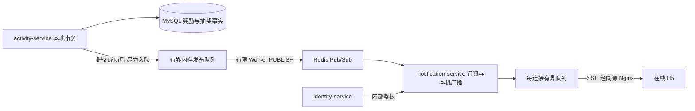

# notification-service 设计方案

日期：2026-11-04。状态：设计稿，尚未实现、联调或压测。

依据：`Lottery业务需求文档（不含后台）.md` 第10节、`持久层设计方案V2.md`、现有账号与榜单服务方案，以及本次确认的“弹幕非核心业务，允许消息丢失”。

## 1. 技术选择与边界

采用 **Redis Pub/Sub 解耦 activity-service 与 notification-service，SSE 向在线 H5 广播**。复用项目已有 Redis；通知服务不建业务数据库，不保存离线消息，不引入弹幕专用 MQ、Outbox、Inbox 或死信队列。

Redis Pub/Sub 是即时广播，订阅者不在线或断线时消息不会保留，适合本项目允许丢失的展示消息。PUBLISH 返回的订阅数不等于浏览器收到或播放成功；返回0也属于允许的丢弃场景。[Redis 官方 Pub/Sub 语义](https://redis.io/docs/latest/develop/pubsub/)

|备选|本项目判断|
|---|---|
|Redis Pub/Sub|选用；已有依赖，支持每个通知实例都收到在线广播|
|RabbitMQ|榜单可靠事实链路已规划使用；弹幕无需其持久化、确认与补偿机制，本期无需另设队列|
|Redis Streams|保留历史、消费确认和重放不符合当前弹幕需求，不使用|
|直接 HTTP 调用通知服务|会耦合实例寻址和故障处理，多实例广播还需额外转发，不选|

SSE 适用于服务端单向推送文本；不需要客户端发言、消息 ACK 或聊天协议。客户端普通业务操作继续走 HTTP。

**本次规则优先于原开发规划第4.3节关于内部事件可靠投递的通用描述：弹幕展示事件允许从提交后发布、Redis 转发、服务端排队到客户端播放的整个链路丢失。** 账号初始化、榜单积分、排名奖励等可靠事件继续按各自方案处理；不能把它们改成 Pub/Sub。

## 2. 总体链路



1. activity 完成本地事务，扣费、发奖、进度、逐抽结果等仍以 MySQL 提交为准。
2. 仅从本次实际新发放或实际完成选款的结果构造允许播报的事件，事务失败不发。
3. 提交后非阻塞尝试放入有界内存队列。入队失败直接丢弃，不改变成功响应；HTTP 请求不等待 Redis 或通知服务。
4. 固定数量 Worker 使用独立、带超时的服务级 context 发布，不能沿用即将结束的请求 context。进程在提交后入队前崩溃、队列未发送就退出均允许丢失。
5. notification 收到后校验消息，映射展示内容，广播给本机已认证连接。各连接独立消费队列并写 SSE。

不启动“每条消息一个 goroutine”的无限并发；不在事务中 PUBLISH；不查询历史奖励补发弹幕。幂等重试恢复既有结果时不重新产生展示事件。提交结果未知时不播报，以实际确认提交成功的新业务变更为触发点。

## 3. 哪些奖励播报

|来源/状态|播报|
|---|---|
|普通正式抽奖直接获得具体戒指|是，按逐条奖励明细生成事件|
|普通抽奖的选择权完成选款|是，使用最终具体款式|
|先抽后付奖励经普通奖励选款流程完成选款|是|
|未选款选择权、金币、花瓣、先抽后付预览|否|
|先抽后付确认直接获得具体戒指|否，保持原接入范围|
|阶段奖励、宝箱及其选款|否，保持原接入范围|

多抽获得多条戒指奖励时可以生成多条消息，不为通知新增抽奖汇总事实。不排除中奖本人，不按接收人的当前奖池或期次过滤。频道按环境区分，业务字段保留期次仅供追踪。

## 4. Pub/Sub 契约与发布策略

频道：`activity:{env}:notification:ring-awarded:v1`。Redis Pub/Sub 不按 Redis 逻辑数据库隔离，环境前缀和 ACL 必须显式配置；使用精确 SUBSCRIBE，不同时使用匹配同频道的 PSUBSCRIBE，避免重复收取。

建议消息结构：

```json
{
  "schema_version": 1,
  "event_id": "ring:reward-detail-id:granted:v1",
  "event_type": "ring_awarded",
  "occurred_at": "2026-11-04T12:00:00Z",
  "expires_at": "2026-11-04T12:00:30Z",
  "edition_id": "edition-id",
  "source": "normal_draw",
  "display_name": "花开几许",
  "item_id": 1207244,
  "item_name": "烟花之恋戒指",
  "quantity": 1
}
```

- `event_id` 依据已提交奖励明细的全局唯一标识和状态转换构造；不能只用批次ID，否则多抽奖励会被错误去重。完成选款使用对应奖励明细的 `selected` 转换标识。
- `source` 仅允许 `normal_draw`、`normal_draw_selection`、`pay_later_selection`。以核心应用层的来源规则判断，不依据“道具是戒指”一个条件广播全部奖励。
- 公开昵称按 identity 的公开资料定义生成快照，优先昵称、空昵称回退账号名。使用请求已取得的可信资料；无快照时发布 Worker 可有限时调用 identity 公开资料接口，失败丢弃，不在抽奖事务内增加依赖。通知服务不逐连接查询昵称，不接收前端自报昵称作为可信事实。
- 消息不包含 Token、手机号、余额或完整业务快照。内部日志可关联事件ID；浏览器只接收展示必需字段和消息ID。
- 发布尝试一次，超时结果未知也不重试。Worker 出队前检查过期，超过展示期限直接丢弃。期限是防积压的技术参数，不是奖励有效期，也不设置 Redis 消息 TTL（Pub/Sub 不存消息）。
- Redis 客户端关闭自动重试及断线离线命令积压；即使客户端出现不确定重复也由稳定ID与客户端去重兜底，不能宣传端到端恰好一次。
- 校验版本、来源枚举、字段长度、数量和总大小；非法消息丢弃并记录指标，不做补偿。文本用 JSON 编码，前端文本节点展示，不能拼 HTML。

所有通知实例各自订阅同一频道，各自广播到本机连接。不能用一个竞争消费队列让消息仅到某个实例，也不能使用全局 Redis SETNX 去重导致其他实例收不到应广播的消息。初期单实例；多实例时同样适用，无需粘性会话。

## 5. SSE HTTP 接口与认证

接口：`GET /api/notification/v1/barrage/stream`，由 Gin Handler 承接。成功响应：

```text
Content-Type: text/event-stream; charset=utf-8
Cache-Control: no-cache, no-store
X-Accel-Buffering: no

event: ready
data: {"status":"connected"}

event: barrage
id: ring:reward-detail-id:granted:v1
data: {"message_id":"ring:reward-detail-id:granted:v1","display_name":"花开几许","item_name":"烟花之恋戒指","quantity":1,"expires_at":"2026-11-04T12:00:30Z"}

: heartbeat

```

每个事件以空行结束，写完 Flush。`id` 用于客户端去重；收到 Last-Event-ID 也不查历史、不补发。心跳采用注释帧，不进入弹幕队列。ready 只在鉴权成功、订阅可用且本连接注册完成后发送；它不是历史消息边界或必达承诺。SSE 格式与代理缓冲约定参考 [MDN SSE 文档](https://developer.mozilla.org/en-US/docs/Web/API/Server-sent_events/Using_server-sent_events)。

### 5.1 使用带 Bearer 的 fetch 读取 SSE

现有 identity 方案是 Access 保存在 H5 内存、Refresh 放在仅 identity 路径的 HttpOnly Cookie。原生 EventSource 构造参数不能直接设置 Authorization，因此本期选择 **fetch + Authorization: Bearer + 流式 SSE 解析**；仍然是 SSE 协议，不为通知另外建登录会话，也不把长期 JWT 放进 URL。

H5 使用经过验证的 SSE 解析器，正确处理 UTF-8 分块、多行 data、CRLF、注释及跨网络块的半条事件，不能把一次 read 当成一条消息。fetch 的 headers、ReadableStream 和 AbortController 能覆盖所需能力，参考 [MDN Fetch 文档](https://developer.mozilla.org/en-US/docs/Web/API/Fetch_API/Using_Fetch)。后续实现时核实所用 H5 浏览器对流式读取的支持。

### 5.2 鉴权生命周期

- 连接建立前本地验 Access，并调用 identity 内部会话校验；禁止直接读账号库。401 表示无效认证；依赖故障503；连接配额超限429，并提供 Retry-After。
- 已连接每30秒重新校验，定时器加入抖动；同实例相同 sid 与同一 Token 的连接可合并同轮并发校验。校验失败或超时关闭连接；Access 到期也关闭，服务端不接受流内更换 Token。
- HTTP 流一旦开始，不能再把状态码改成401。可尽力发送 `auth_required` 或 `unavailable` 控制事件后关闭；客户端即使未收到控制事件也按连接关闭处理。
- H5 重建连接前使用现有认证模块获取有效 Access，刷新沿用 identity 的 singleflight/多标签协调，不能由每条 SSE 各自竞争刷新。退出立即 Abort 并清理本页弹幕队列和会话去重状态。
- 退出后的服务端关闭存在至多一个周期加校验超时的延迟；不能承诺退出瞬间中断长连接。每30秒校验意味着大约“活跃会话数÷30”的周期鉴权负载，压测必须计入 identity/MySQL 成本。

默认同源 Nginx，不启用任意源 CORS。Redis 仅内网可达，activity 只获准对应频道发布，notification 只获准订阅，不信任浏览器提交的广播事件。

## 6. 队列、背压与资源释放

以下为待压测的可配置初值，不是已验证容量或业务 SLA：

|参数|初值|超限处理|
|---|---:|---|
|activity 发布队列|1,024条|丢弃新消息|
|发布 Worker|2个|固定并发，不临时无限扩容|
|单次发布/资料查询超时|各200毫秒|丢弃；不阻塞抽奖响应|
|展示消息存活时间|30秒|出队及转发时丢弃过期消息|
|内部单条消息上限|4 KiB|拒绝超大事件|
|notification 本机分发入口|1,024条|丢弃新消息|
|每条 SSE 发送队列|32条|丢弃该连接的新消息|
|单次写入及 Flush 截止时间|5秒|关闭慢连接并清理队列|
|心跳间隔|15秒|失败关闭连接|
|实例总连接上限|1,000条|返回503；须按资源测量调整|
|每 sid 连接上限|5条/实例|返回429；是资源配额，不是账号业务限制|

订阅接收与网络写入分离，Pub/Sub 读取循环不能同步等待任何客户端。广播只做非阻塞入队；一个慢用户不能拖住其他用户。服务端队列和浏览器队列分别有界，不能只控制浏览器内存。

每连接只保留必要引用，尽量共享已编码的不可变消息字节，避免每连接复制完整事件。内存与“连接数×每连接队列深度”相关；网络出口约为“广播条数/秒×在线连接数×每条编码字节数”，SSE 不消除广播流量。

通过响应写截止时间限制阻塞；SSE 路径不能套用普通请求的短整体超时。连接的写入由单一写循环串行处理，包含心跳和控制帧；不能并发写同一个响应。连接取消、写失败、鉴权失败、服务退出均取消子任务并注销；Hub 使用单一所有者或锁保证注销/广播安全，防止向已关闭 channel 写入。

若部署多实例，当前 sid 限额为每实例限制，不宣称全局精确限额；暂无必要为此增加分布式连接登记。

## 7. 客户端播放与重连

- 登录后进入首页建连接，收到 ready 才标记连接成功并将连续失败次数清零。每个页面至多一个连接；没有真实消息时不造假填充。
- 当前播放加待播合计最多100条，满时忽略新消息。已过期的待播消息可跳过，避免高峰后播放陈旧消息。
- 同时检查待播ID与已播放ID；同一登录会话最近200条已播放ID保存至 sessionStorage，刷新恢复。待播队列不作为历史补偿持久化。
- 浏览器是最终播放去重边界。服务端无需持久 Inbox 或 Redis 去重键；内存/客户端去重丢失后可能重复，这属于展示层允许范围。
- fetch 不自动重连，统一由一个状态机处理：网络错误、非主动 EOF、建连失败计入连续失败，使用1/2/4/8/16秒退避并加入抖动；累计5次进入异常状态，显示“点击重连”，不再自动尝试。429/503 同时遵守 Retry-After。
- 401 先由认证模块恢复 Access，恢复失败转登录；认证无效不能无限循环重连。手动重连重置失败次数。主动退出、离开页面、主动更换过期 Token 不计为网络故障。
- 页面切后台保持连接；回前台发现断开时只触发一次恢复流程，已进入5次失败的异常状态则仍等待手动重连。网络断开、鉴权刷新与 visibilitychange 共用同一状态机，避免重复连接。
- 不补断线期间消息。弹幕不是中奖凭证，奖励查询和资产展示继续调用 activity。

## 8. 故障与降级

|场景|行为|
|---|---|
|核心事务回滚|不构造可发布弹幕|
|提交后进程崩溃|允许这批弹幕丢失，事实不变|
|Redis 超时、无订阅者、发布队列满|丢弃，增加分类计数，抽奖照常成功|
|通知服务离线或订阅断线|期间消息丢失；订阅后台退避恢复，不回放|
|订阅不可用|拒绝新流503；已有流尽力通知 unavailable 后关闭，避免只有心跳却显示连接正常|
|消息非法、过期|直接丢弃，不补偿、不死信|
|客户端慢、队列满|丢弃该连接的新消息；写超时关闭该连接|
|identity 不可用|新连接503；存量连接下次鉴权失败后关闭，不影响其他服务已提交事实|
|通知实例重启|连接断开，由客户端重连，丢弃内存消息|

Pub/Sub 消息与业务请求完全解耦，但共享 Redis 仍存在 CPU、内存和带宽竞争。使用独立客户端连接/池、频道 ACL 和消息大小限制，关注现有限流、会话及榜单延迟；实际测出竞争后再评估拆实例，不提前增加部署组件。

## 9. 分层与部署

沿用 `services/notification-service/internal/notification/`：

|层|职责|
|---|---|
|domain|展示消息值对象、来源规则、大小/过期等纯规则；不强造持久聚合|
|application|接收与校验事件、订阅连接、广播编排、鉴权周期；声明 IdentityVerifier、连接订阅等端口|
|infrastructure|Redis 订阅适配、有界内存 Hub、identity 内部 HTTP 客户端、时钟与指标|
|interfaces/http|Gin 路由、Bearer 提取、状态码与 SSE 编解码、Flush/写截止时间、取消处理|
|interfaces/messaging|Pub/Sub 入站适配，将传输数据交给应用用例|

应用层使用标准 context.Context，不依赖 gin.Context、Redis 客户端或 HTTP ResponseWriter。核心服务另在其应用层增加“提交后尽力发布”端口，由基础设施实现队列和 Redis 发布。当前只设计，不编写业务代码或执行 DDL；通知服务不需要 migration。

初期 Docker Compose 单实例，复用 Redis 和同源 Nginx；SSE 路径关闭 proxy_buffering、proxy_cache 与可能积攒数据的压缩，proxy_read_timeout 初值60秒，大于15秒心跳间隔。确认所有中间层都即时转发，不能只调用 Gin Flush 就认定浏览器已收到。公网优先 HTTP/2，同一浏览器多个标签页使用 HTTP/1.1 时会受到每域连接数限制，需联调验证。

存活探针只表明进程运行；就绪检查要求订阅确认且能建立新连接。启动先确认 SUBSCRIBE 成功再就绪；订阅丢失撤销就绪。关闭时先停止接纳、撤销就绪、取消连接与订阅，在有限期限内退出，不等待消息可靠排空。初期不部署多实例负载均衡、独立注册中心或专用网关。

## 10. 后续实现验收

1. 回滚、普通抽奖重试、重复选款不新发弹幕；多抽不同奖励ID不会误去重。
2. 对照第3节覆盖所有来源；金币、花瓣、未选款、预览、阶段及宝箱消息不越界，本人消息可见。
3. 关闭 Redis、通知服务或杀死发布进程，抽奖仍完成且奖励可查询；恢复后不回放遗漏消息。
4. 双通知实例各连一个浏览器，两者均收到同一广播；断线期间不补发。
5. 模拟慢连接和广播高峰，验证队列有界、其他连接正常、写超时清理及无 goroutine 泄漏。
6. 校验 SSE UTF-8 分块、多行字段、心跳和 Nginx 实时透传；验证1/2/4/8/16秒退避、5次停止和手动重连。
7. 验证 Token 到期重建、退出/撤销周期关闭、依赖503、刷新 singleflight，以及日志无 Token。
8. 验证200条已播去重、100条播放队列、退出清理、刷新恢复和不伪造填充。
9. 压测活跃连接、广播条数与大小、出口带宽、RSS、CPU、GC、连接清理及周期鉴权负载，再调整上述初值。

监控发布入队失败、PUBLISH失败/零订阅、订阅状态、非法/过期丢弃、各级队列丢弃、活跃连接、写超时、鉴权延迟和重连失败。以指标聚合故障，避免为每条正常消息或每次丢弃刷日志；不能把“写入成功”指标命名为“用户播放成功”。
