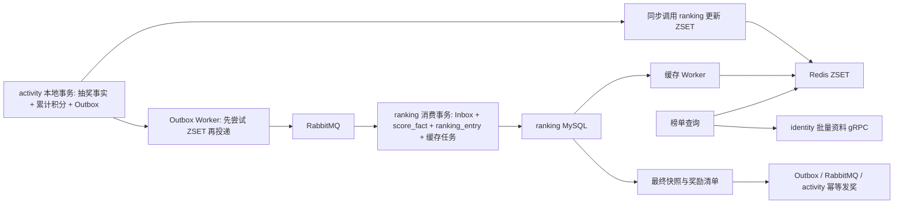

# ranking-service 设计方案

> Redis 写入顺序、幂等与恢复流程以 [榜单 Redis 先写与故障恢复](榜单Redis增量实现.md) 为准。下文保留早期设计背景。

日期：2026-11-04。状态：主体已实现；2026-11-05 追加资料 gRPC 客户端与可恢复结算。

> 实施说明（2026-11-05）：昵称查询已改为 identity gRPC `BatchGetPublicProfiles`，ranking 侧有 200ms 截止、60s fresh/10m stale 缓存；`/internal/identity/v1/profiles` HTTP 接口已删除。结算已实现 cursor/lease 状态机 `PENDING→RECONCILING→FROZEN→AWARDING→COMPLETED`，冻结后拒绝新积分事实，排名奖励与 outbox 批量写入；具体验证记录见 [后端实现与验收](后端实现与验收.md)。榜单 Redis generation/rebuild 仍按 [榜单Redis增量实现](榜单Redis增量实现.md) 的收窄范围，未在本轮扩展。

依据：[业务需求 V1.2](Lottery业务需求文档（不含后台）.md)、[持久层设计 V2](持久层设计方案V2.md)、[现有榜单 DDL](../services/ranking-service/migrations/001_initial.sql)。

## 1. 设计结论与服务边界

采用“核心 MySQL 事务提交 → 同步调用 ranking 更新 Redis ZSET → Outbox / RabbitMQ → 榜单 MySQL 异步落库”的主链路。MySQL 保存原始积分事实、积分投影、最终排名快照和奖励清单；ZSET 尽快反映已提交的积分，消费端负责核对与补偿。Redis 可以重建，不能作为补写权威事实的唯一来源。

Redis 故障或同步调用超时不能阻止可靠事件投递，也不改变已提交抽奖的成功结果。“ZSET 在 MQ 前”是正常路径的优先顺序，不是跨系统原子事务或故障时必须满足的顺序。

用户名通过 identity 的批量 gRPC 接口补齐，昵称不进入排序键或榜单事实表。当前 identity 方案采用内部 HTTP，本设计新增的是资料批量查询 gRPC 契约，不迁移既有认证 HTTP 或账号创建 HTTP 链路；实施时需同步扩展 identity 方案。

|服务|负责|不负责|
|---|---|---|
|activity-service|正式扣费与抽奖事务、累计积分与版本、参与初始化、业务时间与抽奖序号、截止门禁、奖励实际入账|直接写榜单数据库或榜单 Redis|
|ranking-service|积分消费与核对、排名查询、冻结快照、排名奖励清单与投递跟踪|扣费、抽奖、钱包和真实奖励入账|
|identity-service|账号、当前昵称、认证与资料查询|提供排名或积分|
|notification-service|已有业务范围的实时通知|保存排名事实或参与榜单发奖|

只新增业务所需 RabbitMQ，不引入独立网关、注册中心或其他数据库。无流量和资源测量数据，不预设 QPS、Redis 分片或 RabbitMQ 集群规模。

## 2. 业务口径

- 正式消耗 1 花瓣计 1 分；普通抽奖按实际消耗计分，先抽后付仅确认成功计分。购买、补差、预览、领奖、选款、开箱均不计分；未执行退款部分不计分。
- 按期次累计，换轮不清零；注册及新期初始化建立 0 分记录。0 分用户可以上榜，也没有必须正分才能获奖的条件。
- 唯一排序为 `score DESC, score_reached_at_sec ASC, user_id ASC`。名次连续为 1、2、3，不使用并列名次。
- 达分时间取活动核心的业务时间，精度为秒，不用 MQ 接收时间或消费时间。0 分使用参与创建时间。
- 正分每次推进连续抽奖序号后，达分时间取该连续前缀最后一笔正式抽奖时间；核心须保证同用户业务时间不随序号倒退。预览兑现使用确认产生正式抽奖的时间。
- 展示 Top 20 和本人名次；没有本人数据才返回未上榜。允许短暂延迟，不新增“五秒必可见”等承诺。

## 3. 总体数据链路



MQ 不在用户抽奖同步请求中等待；抽奖成功由核心 MySQL 提交决定。RabbitMQ 不可用时 Outbox 保留待投递，榜单延迟增加；不能回滚已成功抽奖，也不能丢弃待投递事件。

同步更新接口建议使用私网 HTTP，初始 deadline 100ms，属于可调技术参数。抽奖响应在同步尝试成功或超时后返回，失败依靠 Outbox 持续恢复。即使用户请求取消，已提交的 Outbox 仍独立投递。

为避免 Outbox Worker 抢先发 MQ，Worker 在每次发布正式抽奖/初始化事件前，也先调用同一个 ZSET 更新接口；正常成功后再发布，超时或 Redis 故障仍继续发布。请求路径与 Worker 重复调用通过版本幂等处理，不能用内存标记保证顺序，也不额外持久化一个必须成功的 Redis 前置状态。

## 4. ZSET 复合 score 排序

### 4.1 本期采用的公式

可定义 `packed = rawScore * base + endSec - achievedSec`，按 packed 降序。设本期全部合法达分时间范围为 `[minSec, maxSec]`，必须满足：

1. `base > maxSec - minSec`，保证 1 分差距始终高于时间项差距。
2. 整个 packed 范围均为精确可表示整数，最坏绝对值不超过 `2^53`；先用整数进行溢出和边界校验，再转换为 Redis score。
3. endSec、时间单位和 base 按期次固定，不在活动中途更换编码参数。0 分用户可能在活动开始前初始化，时间范围不能只按活动时长估算。
4. 同分同秒时还要按 user_id 升序。降序读取 ZSET 的同 score 成员会按逆字典序返回，不能直接使用普通十进制 user_id；可用补齐 20 位的 `UINT64_MAX-user_id` 作为 member。

活动通常约一个月，本期确认采用该公式。以完整合法时间跨度为 30 天、base=2592001 为例，扣除最坏时间项后，可精确表示的积分上限约 34.75 亿。实际 base 按本期完整合法时间范围确定；31 天或包含活动前初始化时须重新计算，不能固定套用 30 天常量。

期次配置保存固定 endSec、minSec、maxSec、base 和技术编码上限。启用前按预期业务积分量级校验，写缓存前再次用整数精确校验。该上限是编码保护，不是新增业务积分上限：若意外越界，保留已提交的 MySQL 事实与事件，将该期缓存置为不可用并转 MySQL 查询、报警处理，不能截断、四舍五入或拒绝已成功抽奖。此时即使榜单落库尚有延迟，也不返回错误编码的排名。

Redis 官方说明 ZSET score 使用 double，只有 `[-2^53, 2^53]` 范围内的整数都能精确表示，见 [ZADD](https://redis.io/docs/latest/commands/zadd/)。不能再用小数位塞时间或用户 ID 来规避这个限制。

### 4.2 成员编码与查询

ZSET score 为 packed，member 使用固定宽度的反向用户 ID：

```text
member = pad20(UINT64_MAX - userID)
```

降序读取时，积分高者先出；同分较早达分者 packed 更大；同 packed 时反向 ID 的逆字典序让较小用户 ID 先出。编码使用无符号整数及补零字符串，不将用户 ID 转成 float64。member 在该用户同一期内保持不变，不需要随积分删除重建成员。

|操作|命令语义|
|---|---|
|取前 20|`ZRANGE boardKey 0 19 REV`|
|定位本人|由 userID 编码 member，再 `ZREVRANK boardKey member`；返回值加 1|
|读取原始分数|从同版本 Hash 元数据取 rawScore、achievedSec；不把复合 ZSCORE 展示为业务分数|
|更新|原子 ZADD 覆盖该 member 的 packed，并更新原始积分、时间和版本元数据|

更新、查个人名次复杂度约 O(log N)，Top 20 为 O(log N + 20)，缓存空间 O(N)。每期固定一套编码参数，禁止中途修改 base 后直接混写。

### 4.3 Key、版本与原子性

建议每期使用 `ranking:{editionID}:g{generation}:board`（ZSET）和 `...:users`（Hash，userID → 原始积分、达分秒、版本），另有 active generation、ready 与写入门禁标记。初期单 Redis；同花括号也便于原子操作保持同槽，不表示当前引入集群。

同步调用携带核心事务生成的完整累计积分、达分秒和 draw_seq 作为版本；消费补偿使用 MySQL 投影的 last_contiguous_seq，二者使用同一版本空间。不携带“请再加 N 分”的操作，不在两个入口使用 ZINCRBY。Lua 比较版本，旧版本忽略；同版本同数据幂等返回，同版本不同数据报警。版本为定宽整数串进行比较，不能用 Lua number 比较任意 BIGINT。packed 由 Go 完成整数边界校验后传入，Lua 不负责 BIGINT 乘法。

Lua 原子执行版本检查、ZADD 和 Hash 更新；初始化 seq=0 只允许创建缺失数据，不能覆盖 seq>0。同版本发现 ZSET 成员缺失时允许依据一致元数据修复。本人查询与 Top 20 及其元数据在一个只读脚本内取得，元数据不完整时转 MySQL 并触发修复。请求中的所有排名和积分来自同一缓存代，不拼接 MySQL 分数与 Redis 名次。

同步入口只接受 activity 的受认证内部调用，客户端不能提交积分；校验期次、固定编码参数、数值范围和版本。该接口只写缓存，不提前插入 Inbox 或 score_fact，否则 MQ 到来可能被错误去重。

## 5. MySQL 模型与积分事务

### 5.1 核心事务保存完整累计投影

为支持 MQ 落库之前更新 ZSET，activity 不能从可能滞后的榜单 MySQL 读取旧积分后相加。设计新增 `user_participation.ranking_score`、`ranking_score_reached_at_sec`，与已有 draw_seq 一起，在受锁的参与记录上随正式抽奖事务更新；初始化为 0 分及参与创建时间，换轮不清零。累计加分使用实际消耗，达到新积分的时间取本次正式单业务秒。

该事务写入的 Outbox payload 同时保存本次 consumed_petals、事务结束后的 total_score、score_reached_at_sec 和 draw_seq，作为该次提交的不可变投影快照。请求路径和发布 Worker 均使用此快照，不在重试时拿旧序号搭配最新积分。无需为每笔抽奖额外复制整份用户状态。

这是相对持久层 V2 的明确设计增补，后续实施须同步修改 V2 与核心 DDL；现有 user_participation 尚不包含上述两个新增字段，本轮不修改或执行迁移。核心累计值可由正式抽奖事实核对；榜单事实投影仍由本服务独立计算，不能以 Redis 值反推权威积分。

### 5.2 榜单消费事务

沿用 `activity_ranking`，本期不分表：

|表|职责与约束|
|---|---|
|score_fact|正式单原始事实；draw_id 主键，`(user_id,edition_id,draw_seq)` 唯一；保存真实消耗及业务秒|
|ranking_entry|每用户每期一行，包含 0 分；保存原始累计 score、达分秒、最大连续序号，不保存可变名次|
|ranking_settlement|截止清单、奖励规则快照、冻结与完成状态|
|ranking_snapshot|不可变全榜快照，期次用户与期次最终名次分别唯一|
|ranking_award|每奖励项一行；稳定 award_id；期次用户奖励项唯一|
|inbox_event / outbox_event|消费去重与可靠发布；使用现有租约、退避、重试字段|

消费正式抽奖事件时：

1. 验证事件版本、来源、正消耗、期次、序号和业务时间；取得期次写入门禁，再锁该用户 ranking_entry。
2. 同事务登记 Inbox 并插入 score_fact；重复 event_id 返回成功。即使 event_id 改变，同 draw_id 也必须按业务唯一键去重；同 ID 不同内容为冲突，回滚并隔离告警，不能吞掉冲突后继续加分。
3. 从 `last_contiguous_seq+1` 开始读取已入库连续事实，推进累计分数及最后达分时间。遇缺口停止，后续事实可以先落库，不能越过缺口加分。
4. 更新 ranking_entry，并在同事务写 `RankingProjectionChanged.v1` Outbox 缓存任务，包含完整投影及序号；提交后才 ACK MQ。

例如 seq=2 先到，仅保存事实；seq=1 到达后一次推进 1、2。缺口持续超阈值时通过 activity 内部事实查询补齐，再走同一幂等事务。多消费者并发仍以 MySQL 行锁和唯一键为准，不依赖 RabbitMQ 的到达顺序。

同步缓存可以先到 seq=3，而榜单 MySQL 仍在 seq=1。seq=1/2 的消费补偿不得覆盖 seq=3；等连续事实补齐至 seq=3，再核对计算值与核心 Outbox 的累计投影是否一致。不一致时隔离该期缓存并转 MySQL 查询、告警对账，不能靠同版本覆盖掩盖冲突。MQ 事实缺口不影响已通过完整累计投影更新的缓存，但冻结仍须等待事实补齐。

缓存任务使用现有 Outbox，但由本服务的 Redis Worker 按 event_type 分派处理，不发布到业务 MQ；成功更新 Redis 后标记 PUBLISHED。崩溃重放由序号去重。业务 Outbox 才走 RabbitMQ。实施时明确两种 dispatcher 的筛选条件，避免彼此抢任务。

## 6. RabbitMQ 与事件契约

使用持久化 topic exchange `activity.events`，榜单持久队列 `ranking.facts.v1`，订阅参与初始化与正式抽奖事件；奖励投递和回执使用各自消费队列。消息持久化，发布使用 publisher confirms 及 mandatory/returned-message 检查，无路由也不能记为投递成功。

Broker confirm 只确认 Broker 接收，不等于消费者提交；消费者事务提交后手动 ACK。连接断开可重复投递，采用至少一次语义，通过 Inbox 与业务唯一键实现幂等效果。依据 [RabbitMQ acknowledgements and publisher confirms](https://www.rabbitmq.com/docs/confirms) 与 [Reliability Guide](https://www.rabbitmq.com/docs/reliability)。

|事件|关键业务字段|
|---|---|
|ParticipationInitialized.v1|edition_id、user_id、participation_created_at_sec；与参与创建同事务 Outbox|
|FormalDrawCommitted.v1|edition_id、user_id、draw_id、draw_seq、consumed_petals、occurred_at_sec、total_score、score_reached_at_sec；后两项为本次提交累计投影|
|RankingAwardRequested.v1|award_id、edition_id、user_id、final_rank、reward_entry_no、item_id、item_name、quantity、规则快照引用|
|RankingAwardGranted.v1|award_id、edition_id、user_id、核心 grant_id、granted_at|

公共信封包含 event_id、event_type、schema_version、producer、created_at、trace_id、payload。JSON 中 BIGINT ID、序号和积分使用十进制字符串；gRPC 用对应整数类型，转 JSON 时同样防止前端精度损失。

注册链路继续 identity → HTTP → activity 初始化；activity 提交参与初始化后，再发布榜单初始化事件。新期开启须为既有账号完成参与初始化，可由 activity 分页调用 identity 账号枚举契约完成，不能只在首次抽奖时补 0 分。批处理使用稳定注册时间作为枚举边界，边界后的新账号走创建链路，重复初始化由唯一键兜底。

初始化同样先尝试通过 ranking 更新 seq=0、score=0 的 ZSET，再发布 MQ；批量初始化可采用有界批次接口。失败继续投递，由消费补偿，不要求逐用户阻塞整个初始化流程。

初始化消息晚于抽奖消息时，可先建正分记录，迟到初始化只核对参与创建时间，不清零。冻结前还需核对全部有效参与者，防止漏掉 0 分账号。

瞬时故障退避重试，避免无限立即 nack/requeue 热循环；确定性非法事件进入持久死信队列并告警，重放保留原 event_id。死信发布须成功确认后才 ACK 原消息。数据库不可用时暂停消费并控制 prefetch；待投递和死信不能因默认 TTL 静默丢失。

Compose 开发可单节点 RabbitMQ；持久卷和恢复流程必须明确。单节点没有跨节点容灾能力，生产是否多节点依据部署条件另评估。

## 7. 用户资料与榜单 HTTP 接口

建议 `BatchGetPublicProfiles(user_ids)` 返回 user_id、display_name；identity 内部按昵称非空优先、否则账号名映射，只暴露必要公开资料，不返回密码、会话、令牌或资产。一次最多 100 个 ID，榜单请求对去重后的 Top 20 加本人 ID 一次查询，避免每行一个 RPC。

gRPC 仅在私网开放，通过服务凭据认证，跨主机启用 TLS；使用连接复用和 deadline。初始建议总 deadline 200ms、资料缓存 TTL 60 秒，均为可调技术参数。命中缓存可不查 identity，未命中 ID 批量获取；短期缓存意味着昵称可能短暂陈旧。

资料调用失败不改变积分或名次：已有缓存可回退，无缓存显示“用户”占位，不把服务异常误判成账号不存在。当前认证授权仍沿用 identity 方案，资料降级不能绕过认证失败。不能未经业务确认就把禁用账号从积分榜剔除。

沿用前端 `GET /api/ranking`（前端 request 前缀与反向代理具体路径在联调时核对）：

```text
top_20: [{rank, user_id, nickname, score, achieved_at}]
current_user: {rank, score, achieved_at} | null
```

前三名由同一个 top_20 拆分展示。本人身份来自已验证会话，禁止通过任意 user_id 参数查他人私有状态。achieved_at 使用带时区的 RFC3339 秒级时间。

现有 TypeScript 将 user_id 和 score 定义为 number；实施时应改为字符串并调整展示逻辑，否则 BIGINT 经浏览器会失真；名次限制在安全整数范围内。此次只记录契约修订，不修改前端。

活动进行中查 Redis；缺失、未 ready 或故障时，同一个 MySQL 一致性读事务取 Top 20、本人分数和名次。个人名次为严格排在本人之前的记录数加 1，比较条件与三字段排序完全一致。已有排序索引可用，但计数最坏需扫描大量索引项，降级接口须限制并发和超时，失败返回 503，不能返回伪造空榜。

ZSET 优先更新意味着缓存可能领先榜单 MySQL。降级时允许暂时看到较旧的整份榜单，这是已有短暂更新延迟的取舍；不能拼接核心最新分数和旧名次，也不能用降级结果覆盖更高版本缓存。

活动冻结后读不可变 ranking_snapshot，可重新缓存。没有本人记录才返回 null；依赖错误不能伪装成“未上榜”。

## 8. Redis 修复与重建

同步 ZSET 失败时仍发送 MQ，消费提交后由缓存任务重试完整投影；同步 ZSET 成功但 MQ 延迟时，核心 Outbox 继续投递，最终补齐榜单 MySQL。定期对同版本 MySQL 与缓存数据进行核对；缓存版本领先属于正常待追赶状态，持续超阈值才触发补齐核查，不能误判后回写旧值。Redis 持久化只帮助恢复速度，不能替代 MySQL 对账。

初期选择简单可验证的重建流程：

1. 关闭该期缓存写入门禁并置为未 ready，所有同步更新入口、发布前更新和缓存 Worker 停写，等待在途更新排空。此时同步入口返回可跳过缓存的状态，Outbox 继续向 MQ 投递；等待指定的已提交核心事实边界被榜单 MySQL 补齐，降低重建后回退幅度。
2. 暂停该期投影消费者及缓存 Worker 并等待在途任务结束；核心抽奖继续提交，后续消息在 MQ 中积压。从稳定 ranking_entry 分页构建新 generation 的 ZSET 和 Hash，核对人数、Top 20、个人名次和抽样分数。
3. 原子切换 active generation，开放消费补偿写入门禁，恢复消费及缓存 Worker，但同步入口仍停写；追赶至切换时捕获的核心事实边界后，原子设 ready 并开放同步写入。开放前已提交但未消费的新事件仍会由 MQ 补齐，允许短暂延迟。
4. 观察成功后延迟清理旧 generation，失败保留旧代但继续 MySQL 降级。

所有缓存写入须校验 active generation 与对应写入门禁，暂停控制要覆盖全部实例和全部入口；切换期间旧 generation 请求必须拒绝或重新定位，不能写入旧代后报告新代已更新。若未来重建停顿无法接受，再设计更复杂的快照水位与增量追赶；当前不引入额外 CDC 组件。

## 9. 截止、冻结与奖励发放

activity 编排整体结算，ranking 只承担榜单步骤。状态沿用 DDL：`PENDING → RECONCILING → FROZEN → AWARDING → COMPLETED`；失败保留检查点进入 FAILED，恢复时根据已有不可变产物判断继续哪一步，不重新随机或重复生成奖励 ID。

1. activity 关闭参与门禁并等待已接纳事务排空，形成四张抽奖分表稳定边界、参与者清单边界、规则版本及截止清单。仅队列为空、时间到点或取最大 ID 都不能证明完整。
   同时关闭该期同步缓存入口并排空在途写入，避免迟到调用修改冻结展示。消费补偿仅在核对阶段允许，FROZEN 后关闭实时缓存写入并转快照查询。
2. ranking 通过 activity 分页内部契约获取本期有效事实及参与者，按同一幂等路径补齐 score_fact 和 0 分用户；不跨库读核心分表。核对每用户序号连续、末序号/消耗合计/达分时间、人数与原始事实一致。摘要辅助核对，冲突必须逐笔定位。
3. 结算与普通消费通过期次门禁串行化。初期可锁 ranking_settlement 行协调该期写入，最终锁定期间完成全量排序快照与 FROZEN 提交；接受同一期短暂串行写，吞吐须压测。冻结后相同事实重放只去重，新增或冲突事实隔离告警，禁止直接改最终快照。
4. 按 MySQL 三字段排序生成全榜 ranking_snapshot，并按冻结规则生成奖励清单。数据量较小时单事务完成；大事务承受能力必须测试，未验证前不声称可无限扩展。冻结快照与奖励生成可分步，奖励唯一键和稳定 award_id 保证重试一致。
5. ranking_award 与发奖 Outbox 同事务创建；activity 按 award_id 幂等生成 reward_grant，必要的资产变化同本地事务处理，并写发奖成功 Outbox。
6. ranking 收到核心成功回执后，将该 award 标记 DELIVERED；所有奖励实际入账确认后才标记排名结算 COMPLETED。Broker confirm、消息发出或 HTTP 已接收均不能替代业务回执。回执长期缺失时重发同 award_id 或查询核心幂等结果。

默认奖励沿用需求：第 1 名两项（1323、1207811），第 2～10 名两项（3633、1207809），第 11～20 名一项（3633）；分别保留 90/60/30/10 天规则说明快照。不新增真实定制、穿戴、到期回收。人数不足只发实际名次，0 分也按名次匹配档位。

发现冻结后遗漏有效事实时，停止尚未完成的发奖并报警，走明确的结算修复评审；本期不设计静默修改快照和自动追回已发奖励。

## 10. 目录、实施顺序与验收

沿用服务目录：domain 放排序规则、积分与结算状态；application 放事件消费、榜单查询、核对与冻结用例；infrastructure 放 MySQL、Redis Lua、RabbitMQ 和 identity gRPC 客户端；interfaces 放 HTTP、消息消费者及内部结算接口。应用层通过仓储、事务、事件发布、资料查询端口依赖基础设施，domain 不导入中间件库。

HTTP 统一使用 Gin，Handler 位于 interfaces/http，负责路由、绑定校验与中间件；通过应用接口调用用例，只向下传递标准 context.Context。application、domain 与仓储接口均不依赖 Gin，不传递 gin.Context。内部缓存更新 HTTP 接口也遵守该边界。

契约分别放 contracts/events、contracts/http、contracts/rpc。identity 的批量资料及账号枚举、activity 的参与者/抽奖分页核对接口、ranking 的内部累计积分缓存更新接口均为待实现能力，不能假定当前已有。榜单 DDL 沿用，核心累计投影字段需按第 5.1 节增补；具体 Outbox 类型、状态恢复与接口认证在开发时补充，不在本轮迁移表结构。

实施顺序：先固定复合 score 参数、完整累计投影及消息契约；补充核心模型设计与迁移；实现核心事务累计积分、ranking 同步 ZSET 接口和发布前尝试；接入 RabbitMQ Outbox、MySQL 幂等与乱序补齐；实现消费补偿、Redis 重建、资料查询及 Gin HTTP；最后完成截止核对、冻结与幂等发奖，并联调容器部署。

必须验证：

- 同分不同秒、同分同秒不同 ID，Redis 与 MySQL 顺序一致；0 分初始化不覆盖已有正分。
- 月期时间边界、活动前 0 分初始化、同秒 ID 升序均正确；packed 精度边界及越界触发整期缓存降级，不影响已提交事实；ID 和版本超过 2^53 仍不失真。
- 核心提交后同步调用前崩溃、Redis 成功后 MQ 发送失败、Redis 超时但实际已成功，Outbox 最终补齐事实且不重复加分；Redis 故障不阻塞 MQ。
- 同步 seq=3 先到、MQ 补偿 seq=1/2 后到，缓存不回退；同版本不同累计值告警，同版本成员缺失可以修复。
- seq=2/3 先到、seq=1 后到，正确推进连续分数；重复 ID 改载荷不能静默成功。
- MySQL 提交后消费者崩溃、ACK 丢失、publisher confirm 丢失、Redis 更新后任务状态未提交，重放不重复加分或生成重复成员。
- Redis 全丢、部分 Hash 缺失、旧任务晚到、重建切换，查询不返回错误空榜，版本不倒退。
- identity 超时、部分 ID 缺失时只降级昵称；一次查询不产生 20 次资料 RPC。
- 截止仍有已接纳事务、MQ 有积压、0 分初始化未到，冻结必须等待或核对补齐；不遗漏四张核心分表事实。
- 奖励请求与回执重复或丢失、结算中断恢复，实际奖励仅一份；未收到入账确认不能完成结算。

监控核心 Outbox 年龄、MQ ready/unacked/死信、积分序号缺口、缓存任务积压、MySQL 与 Redis 差异、资料 RPC 延迟及结算进度。具体告警阈值与容量依据压测和运行数据确定，不把技术目标写成新的业务承诺。
