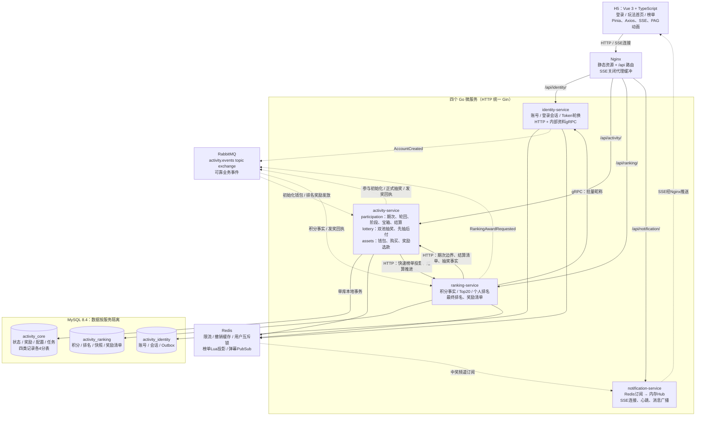
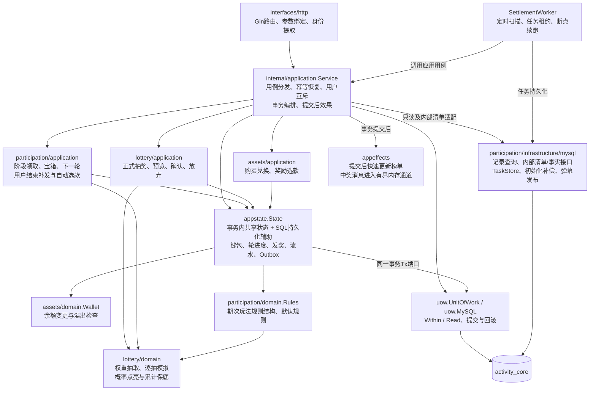
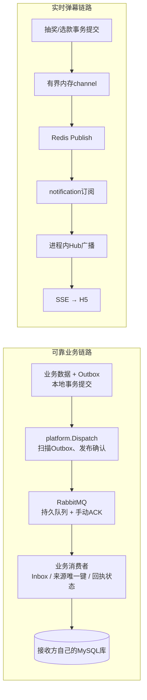

# 当前软件架构图

日期：2026-11-05。依据当前仓库源码及 Compose/Nginx 配置绘制，不依据旧规划推定实现。以下是静态代码视图，不代表本次已经启动服务、通过全部测试或验证线上部署。

分析范围包括四个服务入口与内部实现、共享 platform、RPC 契约、H5 的路由与 API 适配、持久层迁移、容器配置及测试入口。第三方 node_modules、编译后的 dist 和自动生成的 protobuf 文件不作为业务架构分析对象。

## 1. 系统总图

实线表示访问/数据依赖，虚线表示业务消息或实时通知。当前可复现的部署配置是 Docker Compose；Kubernetes 是已明确的最终部署目标，仓库暂未提供相应部署清单。

图中未展开的统一鉴权链路：活动、榜单及通知的受保护入口先用 `platform` 本地验证 Access Token，再 HTTP 调用 identity 的 `/internal/identity/v1/introspect` 检查会话。这里不是完全无状态的 JWT 鉴权，也不是通过 gRPC 做会话鉴权。

## 2. 活动核心内部划分

下面是当前调用和依赖的简化图，并非假定项目已经达到严格的理想分层。

四类记录按 `user_id % 4` 路由：`draw_order_0..3`、`draw_detail_0..3`、`flower_lit_log_0..3`、`wallet_ledger_0..3`。`wallet`、`user_participation`、`user_round`、`reward_grant`、`preview_order` 等保留单表，全部仍在同一核心库事务内。实际数据库访问采用 `database/sql`，没有采用 GORM 或独立分表代理。

当前实现的分层特点：

- 入口层通过应用服务调用业务；活动服务的修改用例由 application 使用 UoW 编排事务。
- `appstate` 同时持有事务内状态和具体 SQL，是当前实现中的共用持久化辅助包，不能把它画成纯领域模型或标准的独立仓储实现层。
- activity 的 `Legacy` 入口仍承担记录查询、内部 manifest/facts/encoding 等接口适配，不代表整个主流程仍是旧实现。
- identity 的注册和会话轮换、ranking 的事实消费和最终快照事务，仍由各自 MySQL 仓储实现控制；不能将活动服务的 UoW 结构概括成四个服务完全一致的实现。
- `pkg/platform` 已集中配置、数据库连接、Redis、鉴权、HTTP响应、ID、消息和进程生命周期；当前是服务共享的技术包。

## 3. 两条异步链路

可靠业务事件与弹幕是两套不同的实现。

可靠链路用于账号创建、参与初始化、抽奖积分、榜单发奖及发奖回执；投递可能重复，接收方按各自机制防重。Outbox 当前通过轮询处理，发布时等待 RabbitMQ 确认；这与数据库变更同消息系统之间的分布式事务不同。

弹幕不经过 RabbitMQ、不进入 Outbox：内存通道和客户端队列可丢消息，Redis Pub/Sub 不补历史，通知服务没有 MySQL。SSE 在连接建立后发送就绪事件、周期心跳并重新校验登录状态。

榜单另有一条提速路径：活动事务提交后短超时 HTTP 更新 ranking 的 Redis 投影；Outbox 发布前也尝试该投影。可靠积分事实仍由 RabbitMQ 消费落 MySQL。榜单优先读 Redis，缓存不可用或覆盖检查不满足时回退 MySQL；Redis 使用 Lua 原子更新、重复抽奖去重及精度边界保护。昵称由内部 gRPC 批量补齐，榜单侧还有短期进程内缓存与失败降级。

## 4. 前端与部署边界

- H5 是 Vue 3 + TypeScript，路由分为登录、首页、榜单；Pinia 保存认证状态，`api/` 将新后端 DTO 转为现有页面模型。
- Access Token 只保存在内存，Refresh Token 使用 HttpOnly Cookie；Axios 负责续期和重试，操作标识在客户端保留以支持请求恢复。
- 弹幕通过带 Bearer 认证的 fetch-event-source 连接 SSE；页面负责播放排队、去重及重连，动画和音效留在 H5。
- 当前 Compose 启动 MySQL、Redis、RabbitMQ、四服务及 Nginx；Dockerfile 通过 SERVICE 参数构建不同 Go 服务。
- Nginx 同时提供 `web/h5/dist` 和 `/api` 转发，内部 HTTP 与 gRPC 不通过浏览器入口转发。
- Kubernetes 最终部署目标尚未体现为 Deployment、Service、Ingress/Gateway 或 Helm 清单。当前服务地址由环境变量配置，不能在“现状图”中标注已使用 Kubernetes 服务发现。

## 5. 源码定位

|架构事实|主要依据|
|---|---|
|四服务启动与后台任务|`services/*/cmd/server/main.go`|
|入口代理与本地容器编排|`compose.yaml`、`compose.services.yaml`、`deploy/local/nginx/default.conf`、`Dockerfile`|
|活动服务事务和用例分发|`services/activity-service/internal/application/service.go`、`internal/uow/`|
|活动三模块业务|activity 的 `internal/participation/application/`、`internal/lottery/application/`、`internal/assets/application/`|
|共享状态、SQL和分表事实|activity 的 `internal/appstate/`、`pkg/platform/platform.go` 中的 `Shard`|
|可靠事件|`pkg/platform/messaging.go` 及各服务的消费者与 Outbox 写入点|
|榜单快速投影与事实消费|activity 的 `internal/appeffects/effects.go`、ranking 的 `infrastructure/mysql/repository.go` 和 `infrastructure/redis/`|
|用户资料RPC|`contracts/rpc/identity/v1/profiles.proto`、identity 的 `interfaces/grpc/`、ranking 的 `infrastructure/identitygrpc/`|
|弹幕发布与SSE|activity 的 `infrastructure/mysql/notification.go`、notification 的 `infrastructure/subscriber.go`、`application/hub.go`、`interfaces/http/routes.go`|
|结算工作流|activity 的 `participation/application/settlement_worker.go`、`infrastructure/mysql/settlement_tasks.go`，ranking 的 `infrastructure/mysql/settlement.go`|
|认证与撤销缓存|`pkg/platform/auth.go`、`platform.go`，identity 的 `application/service.go`、`infrastructure/cache/revocation.go`|
|前端入口与后端适配|`web/h5/src/router/index.ts`、`stores/auth.ts`、`api/`|

仓库包含领域测试、应用测试、Redis/SQL 集成测试和 `tests/e2e`。本次任务为源码分析与画图，没有重新运行这些测试，不能用它们的存在代替运行结果。
